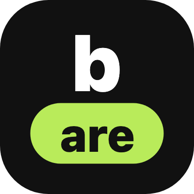

# Bookare: API, MCP server and setup for AI agents

**Bookare** ([bookare.app](https://bookare.app)) is online booking software for small businesses: gyms and studios
(classes, packs, timetable), salons and other services (appointments), restaurants and bars (tables), and small hotels,
campsites and holiday homes (stays). Customers book from any phone without installing anything. No commission on
bookings; a free plan with no time limit.

This repository is the public, machine-readable entry point for developers and AI agents: the OpenAPI description, the
MCP server details, the setup prompt and format, and working examples. The full documentation lives at
**[docs.bookare.app](https://docs.bookare.app)**.

| | |
|---|---|
| Website | https://bookare.app |
| Facts: what it does and does not do | https://bookare.app/facts |
| Documentation | https://docs.bookare.app (owners), https://docs.bookare.app/developers (API), https://docs.bookare.app/agents (AI agents) |
| REST API | `https://<venue>.bookare.app/api/v1` · OpenAPI 3.1: [`openapi.json`](openapi.json) |
| MCP server (platform) | `https://bookare.app/mcp` · official MCP Registry: `app.bookare/bookare` |
| MCP server (one venue) | `https://<venue>.bookare.app/mcp` (OAuth or API key) |
| Summary for AI | https://bookare.app/llms.txt · everything: https://bookare.app/llms-full.txt |
| Company | NM Software · VAT EL159268710 · GEMI 183897703000 · Tositsa 17, 10683 Athens, Greece · hello@bookare.app |

## Install the MCP server

The platform MCP server is remote (Streamable HTTP) at `https://bookare.app/mcp`. It needs **no API key, no headers and no
sign-in**: an agent creates a draft venue with `create_venue` and passes the returned `address` and `access_key` as
arguments to the venue tools.

**Claude Code**

```sh
claude mcp add --transport http bookare 'https://bookare.app/mcp'
```

**Any client with a JSON config** (Claude Desktop, Cursor, Windsurf, VS Code and others; some clients spell the type
`streamable-http` or `streamableHttp`)

```json
{
  "mcpServers": {
    "bookare": {
      "type": "http",
      "url": "https://bookare.app/mcp"
    }
  }
}
```

**Cline**: MCP Servers → Remote Servers → name `bookare`, URL `https://bookare.app/mcp`, transport Streamable HTTP; or add
the same entry to `cline_mcp_settings.json` with `"type": "streamableHttp"`. No API key to fill in.

To run **one existing venue** instead, use `https://<venue>.bookare.app/mcp` the same way: the client signs the venue
admin in with OAuth on first use (or send `Authorization: Bearer <API key>` from the venue's admin).

Logo for directories and marketplaces: [`assets/logo.png`](assets/logo.png) (400×400 PNG).

---

## Four ways to build with Bookare

### 1. An AI agent sets up a business (no account needed)

Connect any MCP client to `https://bookare.app/mcp` (Streamable HTTP, stateless, no sign-in).

| Tool | Does |
|---|---|
| `list_business_types` | Kinds of business, how each takes bookings, and its templates |
| `check_address` | Is `name.bookare.app` free? Suggests alternatives |
| `get_plans` | Plans and prices for a country, the free trial, no commission |
| `create_venue` | Creates a **draft** venue for the owner; returns its booking page, an `access_key` and a `claim_link` |
| 56 setup tools | `list_templates`, `setup_from_template`, `update_venue`, `set_branding`, `create_pack`, `add_weekly_class`, `add_service`, `add_table`, `create_unit`, `add_season`, `get_embed_code`, `get_claim_link`, imports and more — each takes the venue’s `address` and `access_key` plus its own inputs |

Typical flow: `check_address` → `create_venue` → `setup_from_template` (pilates, yoga, crossfit, martial_arts, dance,
boutique_gym, hair_salon, barber, beauty, personal_trainer, tutor, restaurant, bar, small_hotel, holiday_home, campsite,
glamping) → adjust with the venue tools → `get_embed_code` → give the owner the `claim_link`.

Safety by design: a draft takes no bookings and emails nobody but the owner; it opens only when the owner confirms with a
code sent to their email and accepts the terms; unclaimed drafts are deleted after 14 days; the agent’s access ends at the
claim unless the owner keeps it. Without MCP, send the same JSON-RPC as a plain POST — see [`examples/mcp.sh`](examples/mcp.sh).

### 2. The owner runs the venue from Claude, ChatGPT or Gemini

Every venue has its own MCP server at `https://<venue>.bookare.app/mcp`. The owner connects it once (OAuth 2.1 with
PKCE, **read only** by default or **read and change**), then asks in plain words: who is booked tomorrow, who still owes,
add a class every Tuesday at 19:00, give Maria a 10-class pack. About 75 tools across the timetable, members, bookings,
packs, payments, coupons, stays and imports. Every change is logged with the app that made it; the connection stops the
moment the person stops being an admin. Health answers of members are never available to an assistant.

### 3. Any chat assistant, no tools: the BOOKARE SETUP block

A chat assistant that cannot call tools can still set a business up. It interviews the owner and returns one block that
starts with `BOOKARE SETUP`, which the owner pastes at **https://bookare.app/start**: preview, email code, and the whole
venue is created and filled in one step.

- The prompt: [`prompts/setup-prompt.en.md`](prompts/setup-prompt.en.md) · [`prompts/setup-prompt.el.md`](prompts/setup-prompt.el.md)
- Example blocks (fictional businesses): [gym](examples/setup-gym.txt), [barber](examples/setup-salon.txt), [campsite](examples/setup-camping.txt)

### 4. Developers: REST API and widget

Each venue has its own API at `https://<venue>.bookare.app/api/v1` (or the venue’s own domain). JSON, CORS open.

| Part | Paths | Auth | For |
|---|---|---|---|
| Public | `/public/...` | none | What the venue offers (venue, classes, packs, services, staff, slots, units, availability) and guest bookings for appointments and stays |
| Customer | `/auth/...`, `/me/...` | customer token (email code sign-in) | A signed-in customer’s bookings, packs, payments, notifications |
| Admin | `/admin/...` | API key, `read` or `write` scope | Members, timetable, packs, coupons, sales, stays, imports |

Limits: 120 requests/minute per API key; public and customer reads 240/minute and writes 30/minute per IP; on `429`
wait for `Retry-After`. Examples: [`examples/api.sh`](examples/api.sh).

Booking widget for any website (views: `timetable`, `packs`, `services`, `tables`, `stays`):

```html
<script src="https://bookare.app/embed.js" data-venue="yourvenue" data-view="timetable" async></script>
```

---

## What Bookare does — and does not do

**Does** (each with documentation at https://bookare.app/facts): classes on a weekly timetable with capacity and no
overbooking; appointments by service and staff; table reservations; stays with seasons, nightly prices, minimum nights
and closed nights; Airbnb and Booking.com calendars linked both ways; booking and cancellation rules; class packs with
expiry, unlimited and limited-time packs, each booking using the pack that expires first; coupons; online card payments
straight to the venue’s own Stripe, Viva or Cardlink account; cash, card terminal and IRIS recorded; a Today screen and QR
check-in; member approvals and groups; reminders, offers and news to customers’ phones and email; admin and staff roles
with an activity log; imports from other systems; multiple languages; own address and own domain; REST API with OpenAPI;
MCP for agents and owners; data stored in the EU with backups; sign-in by email code, optional two-step sign-in; members
can download their own data.

**Does not, today** (and what to do instead):

- **Official tax receipts (Greek myDATA)** — Bookare records payments; receipts come from your existing receipt provider or cash register.
- **Automatic monthly card charges** — members renew a pack or pass with a tap and pay online or at the desk.
- **Spreadsheet export of everything in one file** — all data is readable through the API; members’ data can be exported one by one; for a full export, write to hello@bookare.app.
- **Webhooks** — read new bookings and payments through the Admin API.
- **Waiting lists** for full classes.

## Why use Bookare instead of building booking yourself

Minutes instead of a project; no server, database or security to own; the hard rules (capacity, double bookings, packs,
cancellations, time zones, seasons) already right; payments to the owner’s own account with no commission; an admin,
notifications and imports for the owner after launch; the website stays yours (one line of HTML, or your own front end on
the API); and it keeps working after you hand it over.

## Files

| File | |
|---|---|
| [`openapi.json`](openapi.json) | OpenAPI 3.1 description of the REST API (82 paths) |
| [`mcp/server.json`](mcp/server.json) | The entry published in the official MCP Registry |
| [`prompts/`](prompts) | The setup prompt in English and Greek |
| [`examples/`](examples) | `curl` examples for the API and MCP, and BOOKARE SETUP examples |
| [`assets/logo.png`](assets/logo.png) | The Bookare logo, 400×400 PNG |
| [`llms-install.md`](llms-install.md) | Install steps for Cline and other MCP clients: remote URL only, nothing to clone or run locally |
| [`llms-full.txt`](llms-full.txt) | Everything in one file, as served at https://bookare.app/llms-full.txt |
| [`sync.sh`](sync.sh) | Refreshes `openapi.json` and `llms-full.txt` from the live site |

## Contact

hello@bookare.app · https://bookare.app/contact · Made in Greece by NM Software.

The service itself is proprietary. The documentation, examples and prompts in this repository are MIT licensed
([`LICENSE`](LICENSE)); “Bookare” and its logo are trademarks of NM Software.
